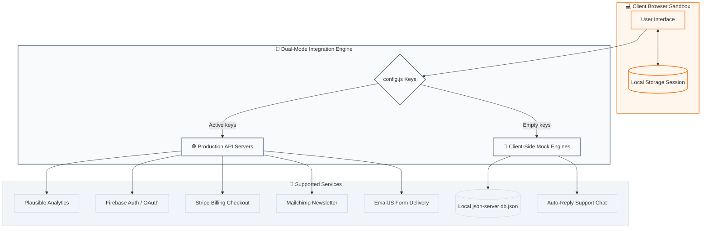

# ⚡ NEXUS ANALYTICS

<p align="center">
  <a href="https://nexus-analytics-smoky.vercel.app/">
    
  </a>
  <a href="https://github.com/DeepParekh9190/Nexus-Analytics">
    
  </a>
  
</p>

Nexus is a developer-first analytics platform built for speed, transparency, and precision. This repository hosts the interactive marketing website, featuring mock dashboards, a local database playground, scroll animations, responsive mobile design, and 8 production-ready external integrations.

> 🔗 **Live URL:** [https://nexus-analytics-smoky.vercel.app/](https://nexus-analytics-smoky.vercel.app/)

---

## 💡 The Nexus Philosophy

Nexus is built for developers who demand **transparency**, **high speeds**, and **absolute control** over their metrics. 

While typical landing pages rely on heavy frameworks, bloated trackers, and static images, Nexus is designed as a **living simulation**:
1. **Zero Bloat**: Loaded dynamically using lightweight, hand-crafted vanilla JS and custom-property CSS.
2. **Local-First Sandbox**: Operates out of the box using client-side memory storage (`localStorage`), ready to scale into production with external APIs.
3. **Graceful Fallbacks**: Every module operates with a "dual-mode" pipeline—automatically detecting active production configuration keys and falling back to clean simulated states if missing.

---

## 🗺️ System Integration Flow

This diagram illustrates the dual-mode data mapping framework of the Nexus Marketing site. The client browser communicates with APIs dynamically, checking configs before routing requests:



---

## 🚀 Sandbox Tour & Pages Showcase

Explore the modular pages of the Nexus ecosystem:

| Page / Module | Destination | Core Interactive Mechanism |
| :--- | :--- | :--- |
| **🏠 Index Hero** | [`index.html`](file:///e:/website/index.html) | Automatic scroll animations (`IntersectionObserver`), customer reviews carousel, newsletter prompt. |
| **⚡ Features** | [`features.html`](file:///e:/website/features.html) | Technical grid highlighting high-performance metrics and network flow charts. |
| **💳 Dynamic Pricing** | [`pricing.html`](file:///e:/website/pricing.html) | Dynamic JS slider mapping event limits (from 1K to 10M) with automatic tier recommendations. |
| **🛠️ Developers Hub** | [`developers.html`](file:///e:/website/developers.html) | star-count parser connected to the GitHub REST API and dynamic code snippets. |
| **🧪 Documentation** | [`docs.html`](file:///e:/website/docs.html) | Interactive API Playground allowing you to customize JSON bodies and test POST responses. |
| **📊 Live Metrics** | [`demo.html`](file:///e:/website/demo.html) | Real-time Chart.js rendering displaying daily visits, active traffic flow, and organic funnels. |
| **🟢 System Status** | [`status.html`](file:///e:/website/status.html) | 90-day history visualizer detailing mock partial outages, resolution notes, and average uptime. |
| **🚪 Authentication** | [`login.html`](file:///e:/website/login.html) / [`signup.html`](file:///e:/website/signup.html) | Email duplicate checker, auto-login redirecting, and Firebase OAuth buttons. |

---

## 🛠️ The Architecture

### 📂 Directory Outline
```plaintext
e:\website/
├── index.html              # Marketing entry
├── docs.html               # API guides & Sandbox playground
├── demo.html               # Chart.js visualization deck
├── status.html             # Operational status board
├── styles.css              # Custom HSL properties design variables
├── script.js               # Event pipelines & integration triggers
├── config.js               # Main configuration endpoint
└── db.json                 # json-server playground mock DB
```

### 🎨 The Palette
Nexus uses a sleek, high-contrast palette styled entirely with CSS variables:
*   **Background (Light)**: `#ffffff` (`--bg-color`) / `#f9fafb` (`--bg-gray`)
*   **Text colors**: Primary `#111827` / Secondary `#4b5563`
*   **Accent highlight**: Orange `#f97316` (`--accent-primary`) / Darker Orange `#ea580c`
*   **Borders**: `#e5e7eb` (`--border-color`)

---

## 📡 Connecting Production APIs

Open [config.js](file:///e:/website/config.js) and fill in your keys. The corresponding module will instantly activate:

```javascript
window.NEXUS_CONFIG = {
  // Contact & Inquiries
  FORMPREE_ID: 'xvgpwdak',                // Mail delivery action id
  EMAILJS_PUBLIC_KEY: 'user_...',        // Client email composer
  
  // Newsletter
  MAILCHIMP_ACTION_URL: 'https://...',   // Mailchimp Audience list link
  
  // Checkout & Paywalls
  STRIPE_PUBLISHABLE_KEY: 'pk_test_...', // Stripe Billing SDK key
  
  // Auth Ecosystem
  FIREBASE_API_KEY: 'AIzaSy...',         // Firebase key for production sign-ins
  
  // Live Playground Database
  JSON_SERVER_URL: 'http://localhost:3000'
};
```

> [!TIP]
> **No backend? No problem.** Leaving keys blank triggers client-side sandbox scripts. For example, form submissions will trigger a local success notification, and login sessions will store accounts inside `localStorage` memory.

---

## 💻 Sandbox Development Setup

### 1. Servicing files locally
Run a local developer server:

**Using Python:**
```bash
python -m http.server 8000
```
**Using Node.js:**
```bash
npx http-server -p 8000
```
Visit `http://localhost:8000` in your web browser.

### 2. Wiring up the API Sandbox (json-server)
To record real data from the docs playground:
1. Start the local server watch daemon:
   ```bash
   npx json-server --watch db.json --port 3000
   ```
2. Turn on the `JSON_SERVER_URL` in `config.js` to point to port `3000`.
3. Payloads sent from Docs will save directly inside your local `db.json` file.
