# ⚡ Nexus Analytics — Marketing Website & SaaS Simulator

[](https://nexus-analytics-smoky.vercel.app/)
[](https://github.com/DeepParekh9190/Nexus-Analytics)
[](https://opensource.org/licenses/MIT)

Nexus is a developer-first analytics platform built for speed, transparency, and precision. This repository hosts the interactive marketing website, featuring mock dashboards, a local database playground, scroll animations, responsive mobile design, and 8 production-ready external integrations.

> 🔗 **Live URL:** [https://nexus-analytics-smoky.vercel.app/](https://nexus-analytics-smoky.vercel.app/)

---

## 🗺️ System Architecture

The following diagram illustrates how the Nexus frontend connects to simulated modules and production-ready APIs:

```mermaid
graph TD
    %% Core Client
    Client["💻 Client Browser"]
    
    %% Production API Integrations
    Client -->|1. Pageviews & Events| Plausible["📊 Plausible Analytics"]
    Client -->|2. Repository Stats| GitHub["🐙 GitHub REST API"]
    Client -->|3. Forms fallback| Formspree["📨 Formspree API"]
    Client -->|4. JS Email Sender| EmailJS["✉️ EmailJS API"]
    Client -->|5. Newsletter Sync| Mailchimp["📮 Mailchimp API"]
    Client -->|6. Payments & Checkout| Stripe["💳 Stripe Gateway"]
    Client -->|7. Multi-Auth / OAuth| Firebase["🔥 Firebase Auth"]
    Client -->|8. Event Logging| JSONServer["💾 json-server (db.json)"]

    style Client fill:#ffedd5,stroke:#f97316,stroke-width:2px;
    style Plausible fill:#f9fafb,stroke:#e5e7eb;
    style GitHub fill:#f9fafb,stroke:#e5e7eb;
    style Formspree fill:#f9fafb,stroke:#e5e7eb;
    style EmailJS fill:#f9fafb,stroke:#e5e7eb;
    style Mailchimp fill:#f9fafb,stroke:#e5e7eb;
    style Stripe fill:#f9fafb,stroke:#e5e7eb;
    style Firebase fill:#f9fafb,stroke:#e5e7eb;
    style JSONServer fill:#f9fafb,stroke:#e5e7eb;
```



---

## 📖 Table of Contents

- [🚀 Overview](#-overview)
- [🛠️ Tech Stack & Architecture](#️-tech-stack--architecture)
- [✨ Core Capabilities](#-core-capabilities)
- [🔌 API Integrations Setup](#-api-integrations-setup)
- [💻 Local Development Guide](#-local-development-guide)
- [🎨 Design System & Animation Specifications](#-design-system--animation-specifications)
- [📈 SEO & Compliance](#-seo--compliance)

---

## 🚀 Overview

Nexus is a complete high-fidelity marketing layout. The platform simulates real-world SaaS logic directly in the browser:
*   **Persistent Auth Flow**: Sign up, log in, reset passwords, and log out with dynamic session mapping (`localStorage`).
*   **Support & Engagement Widgets**: A custom chat assistant widget and interactive modal flows designed to optimize user capture.
*   **Fully Adaptive UI**: Seamless navigation layouts featuring a responsive grid structure and animated mobile navbar.

---

## 🛠️ Tech Stack & Architecture

Built with a zero-framework footprint for optimal rendering performance:
*   **HTML5 Semantic Pages**: 14 distinct files (including legal docs and `404.html`) optimized for search crawlers.
*   **Custom-Property CSS**: Styled using a robust design token system in [styles.css](file:///e:/website/styles.css) (Stripe/Vercel minimalist aesthetic).
*   **Vanilla JS Module System**: Centralized in [script.js](file:///e:/website/script.js) with modular initialization blocks.
*   **Chart.js Charts**: Loads dynamically on the live demo page via secure CDN endpoints.

---

## ✨ Core Capabilities

> [!NOTE]
> All features utilize pure client-side code and persist automatically using native browser APIs until production configurations are set up.

*   **🔒 Session-Retained Authentication**: Custom registration form with email duplicate checks, password length enforcement, and a persistent login state. The global navbar updates dynamically (showing guest vs. profile options) depending on the session.
*   **💬 Support Chat Assistant**: An interactive helper widget offering simulated auto-replies on submissions.
*   **📬 User Retention Banner**: A conversion newsletter pop-up showing after 15 seconds, storing dismissed state to avoid intrusive spamming.
*   **🟢 Service Operational Monitor**: A status dashboard in [status.html](file:///e:/website/status.html) featuring a 90-day operational grid, uptime indicators, and sample outage report histories.
*   **🎛️ Dynamic Pricing Slider**: An interactive pricing grid built with CSS variables that maps monthly event volumes to estimated billing tiers in real-time.

---

## 🔌 API Integrations Setup

To replace browser simulations with live integrations, fill in your credentials in [config.js](file:///e:/website/config.js):

```javascript
window.NEXUS_CONFIG = {
  FORMPREE_ID: 'your_formspree_id',             // Real email delivery
  EMAILJS_PUBLIC_KEY: 'your_emailjs_key',       // JS email composer templates
  MAILCHIMP_ACTION_URL: 'mailchimp_post_url',   // Auto audience list syncs
  STRIPE_PUBLISHABLE_KEY: 'pk_test_...',        // Secure subscriptions
  FIREBASE_API_KEY: 'firebase_api_key',         // Production OAuth
  JSON_SERVER_URL: 'http://localhost:3000'      // Local database tracking
};
```

> [!TIP]
> If these parameters are left empty, the site gracefully falls back to simulated states with zero console errors.

---

## 💻 Local Development Guide

### 1. Launching the Site
Serve the files locally using any simple web server:

**With Python (Recommended):**
```bash
python -m http.server 8000
```
**With Node.js (`http-server`):**
```bash
npx http-server -p 8000
```

### 2. Connecting the Playground Database
To write real request logs from the Documentation API Playground:
1. Start the JSON database daemon:
   ```bash
   npx json-server --watch db.json --port 3000
   ```
2. Make sure `JSON_SERVER_URL` in [config.js](file:///e:/website/config.js) points to port `3000`.
3. Try sending dummy payloads from [docs.html](file:///e:/website/docs.html) — they will record directly inside [db.json](file:///e:/website/db.json).

---

## 🎨 Design System & Animation Specifications

*   **Adaptive Media Query Matrix**: Optimized for screens from full desktop down to ultra-compact viewports (`1200px` / `992px` / `768px` / `480px` / `360px`).
*   **CSS Grid Mobile Navbar**: Layout wraps gracefully to keep logo and hamburger button on row 1, while links (row 2) and full-width buttons (row 3) slide down smoothly with a staggered keyframe animation (`slideDownFade`).
*   **Hamburger-to-X Morph**: The mobile menu toggle button utilizes native CSS transforms to morph from three horizontal bars to a clean "X" layout.
*   **A11y Accessibility**: Animation transitions check for and honor `prefers-reduced-motion: reduce` system configurations automatically.

---

## 📈 SEO & Compliance

*   **Semantic SEO Foundation**: Features descriptive meta headers on all files, proper heading levels, semantic containers (`<header>`, `<main>`, `<section>`, `<footer>`), an optimized `robots.txt`, and a structured `sitemap.xml`.
*   **Performance Metrics**: Integrates lazy image-loading patterns (`loading="lazy"`) for graphics and mockups.
*   **Cookie Compliance**: Displays a custom cookie consent bar on initial entry, persisting permission preferences inside local browser settings.
